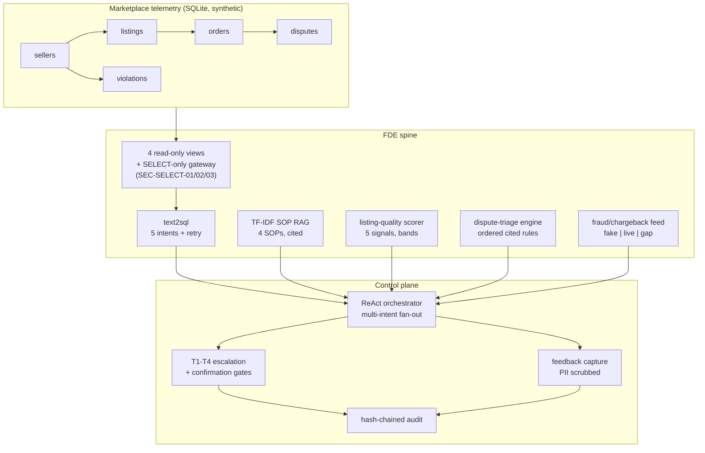

# Architecture

## Data flow
1. A question fans out to text2sql, RAG, the quality scorer, the triage
   engine, and the fraud feed as applicable.
2. High-stakes outcomes (suspensions, >$500 refunds) route through the
   confirmation gate instead of executing.
3. Every step is hash-chained in the audit log; user feedback is
   PII-scrubbed before storage.
